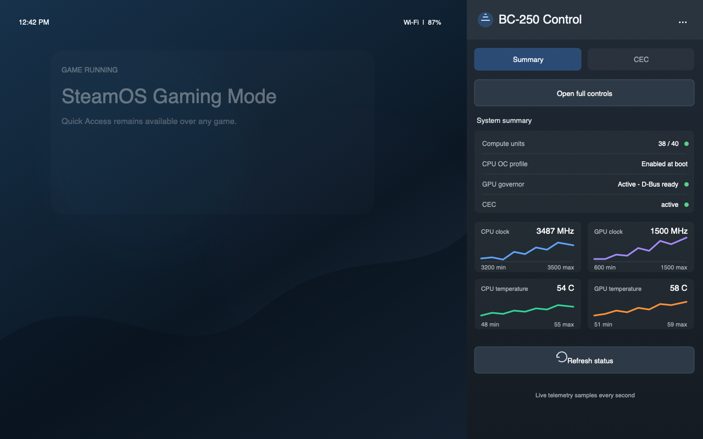
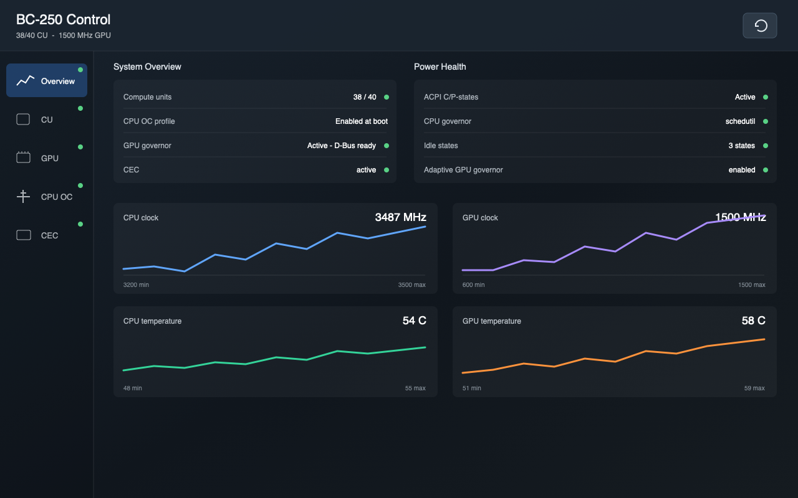
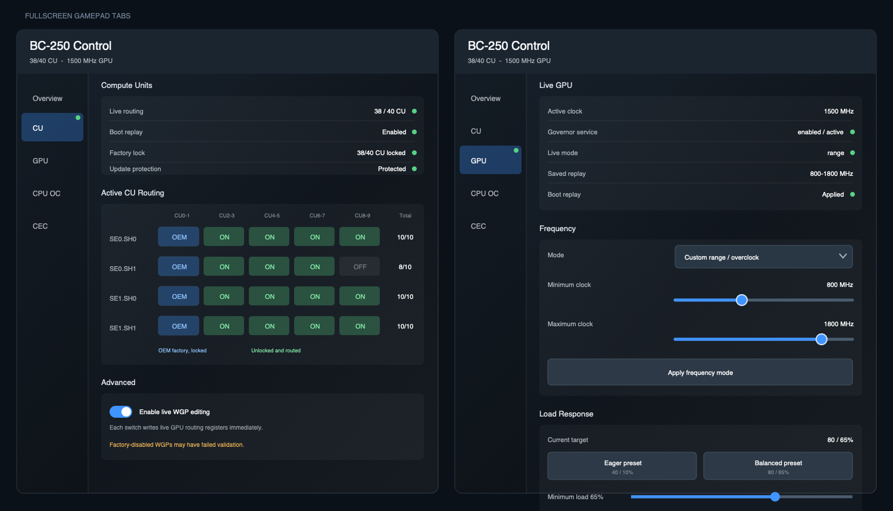
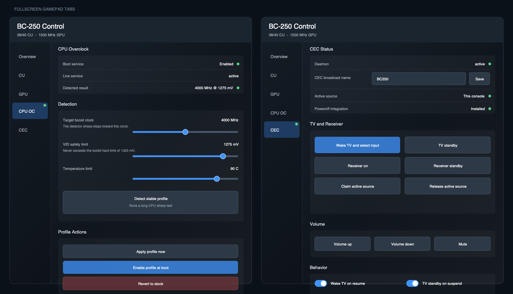

# BC-250 Control

Decky Loader interface for the BC-250 SteamOS toolkit.

## Interface

The Quick Access panel provides a live hardware summary, telemetry graphs, and
CEC quick controls. Select
**Open full controls** for the fullscreen, gamepad-navigable sections:

- CU routing status, saved-table fallback, and guarded live WGP controls
- Full system, ACPI, governor, and all reported hwmon sensors (temperatures,
  power, fans, voltages, and other driver-provided readings with their units)
- GPU frequency, load target, thermal target, ramp behavior/reset, and guarded
  experimental voltage-curve set/add/edit/remove/offset/reset controls
- CPU overclock detection, apply, boot replay, tool update, and stock restore
- CPU topology/core unlock, metrics compatibility, metrics boot-service enable,
  combined core-unlock/metrics uninstall,
  security mitigations, and SMT controls
- RAM / CMOS minimum VRAM and dynamic TTM limit controls
- HDMI-CEC controls
- HDMI Dolby Digital 5.1 / stereo output toggle
- Global DirectMesh / RADV status, installation, and AMDGPU prerequisite
- Retired R2 cleanup before DirectMesh setup, plus a standalone R2 remover;
  original Proton, prefixes, and game settings are preserved. Former R2 games
  need ordinary Proton selection and old `bc250-r2` launch-option removal.
- Installed Steam game discovery with guarded FSR4, HelixSR, and OptiScaler
  install/update/restore controls
- **CLI / Tools**: discovered, allowlisted terminal handoffs for the remaining
  expert and maintenance features; availability reasons and launch errors

Saving WGP routing for boot remains in the toolkit CLI, accessible from
**CLI / Tools → Compute**. Terminal handoffs are functional CLI access, not
native inline implementations or unattended jobs. Switch to **Desktop Mode**
before opening one: terminal windows can be invisible/inaccessible in Gaming
Mode. A successful launch means only that a terminal was requested, not that
the chosen maintenance operation completed. Review its prompts and output.
Global DirectMesh setup also needs sudo: if the frontend cannot authenticate,
it stops before R2 cleanup and directs you to the interactive toolkit CLI.

## Feature coverage

| Toolkit area | Decky interface |
| --- | --- |
| Status, ACPI/C-states, service health, clocks, CPU/GPU graphs | Inline Overview; CLI status for full diagnostics |
| All available hwmon readings | Inline Overview sensor inventory; driver labels/units preserved |
| GPU adaptive/range/pin/max, load presets/custom, thermal target/reset, ramp/set/reset | Inline GPU |
| GPU voltage curve set/add/edit/remove/offset/reset | Inline GPU; experimental acknowledgment plus confirmation per write |
| CU live WGP routing | Inline CU; factory-map protection and confirmation |
| CU save/boot replay and compute setup | CLI handoff: Compute |
| CPU detection/apply/enable/off/tool update, mitigations, SMT | Inline CPU |
| Core unlock test/Linux/EFI/off/uninstall, topology, metrics compatibility/boot-service enable | Inline CPU; backend availability/blockers and reboot guard |
| CMOS minimum VRAM, TTM limit/remove | Inline Memory; persistent-write/reboot warnings |
| CEC and HDMI stereo/AC-3 | Inline CEC/Audio (including quick controls) |
| DirectMesh/RADV, FSR4, HelixSR, OptiScaler and rollback | Inline RADV; ownership/integrity and anti-cheat warnings retained |
| General setup, power install/repair, RAM expert tools, swap, storage | CLI handoffs: Main menu, Power, RAM, Swap, Storage |
| Persistence, Wi-Fi backend, memory-temperature driver | CLI handoffs: Persistence, Wi-Fi backend, Memory temperature |
| RADV expert lifecycle, codecs/kernel builds, Proton, scheduler/KFD policies | CLI handoffs: Complete graphics stack, RADV, Video codecs, Proton, AMDGPU boot policies |
| Toolkit source update, frontend installation, recovery, removal/purge | Distinct CLI handoffs: Toolkit update, Control interfaces, Recovery and maintenance, Component removal and purge |

The backend advertises the actual section titles and availability; unavailable
handoffs show its reason and offer refresh. Advanced and maintenance launches
require confirmation; the CLI still enforces its own prompts and validation.
Kernel builds, system installation, raw expert SMU operations, and toolkit
maintenance are deliberately not duplicated in React. No arbitrary commands,
terminal paths, or shell arguments can be entered through the catalog.

New voltage-curve writes, GPU ramp reset, and CPU tuning-tool update require
their capabilities in the installed backend's optional `controlApiVersion` /
`controlCapabilities` manifest. A legacy service without that manifest keeps
these actions disabled with a plugin/service update notice; older native
controls continue to work. CPU metrics/uninstall availability still comes from
the backend's per-action status. Backend API support is separate from CLI
checkout version/capabilities and does not attest hardware, driver, helper, or
authentication readiness. Updating only the CLI checkout cannot add an API to
an already installed plugin/service; reinstall/update and restart that backend.

Missing readings are displayed as **Unavailable**, never fabricated zeroes.
A real zero (such as a stopped fan) stays zero. CPU/GPU chart roles are not
filled with unrelated memory, board, or storage temperatures. Charts keep only
36 samples of four scalar values; optional sensor arrays are kept only as the
latest inventory. Older backends without sensor arrays still expose their full
legacy temperature inventory. CPU metrics controls remain disabled if the
backend does not advertise their availability; a visible compatibility state
does not itself guarantee a readable sensor.
**Uninstall core unlock and metrics** removes the combined Linux/EFI integration
and metrics payload/service, not only telemetry. Active extra cores require a
full power-off to relock. Enabling the eight-core metrics boot service does not
build/install its matching AMDGPU decoder: install toolkit AMDGPU fixes if the
reported compatibility state requires it, then reboot.

## UI Overview

These mockups follow the implemented Decky React interface and use
representative healthy values from the backend schema. They are UI previews,
not captures from BC-250 hardware; final typography and focus decoration follow
the installed Steam client and Decky theme.

### Quick Access Panel



The plugin opens as a narrow Quick Access overlay without leaving the current
game. **Summary** provides service health and one-second CPU, GPU, and
temperature history. **CEC** switches the same panel to compact TV, input, and
volume actions. **Open full controls** closes the side menus and navigates to
the controller-focused fullscreen route.

### Fullscreen Overview



Fullscreen controls use a vertical gamepad-navigation rail. Hardware tabs carry
a green or amber health dot, and focus moves directly between the rail and the
scrolling content. Overview expands the Quick Access telemetry with power,
ACPI, governor, persistence, CPU profile, CU, and CEC status.

### CU Routing and GPU Tuning



The CU grid distinguishes locked factory WGPs from routed and disabled pairs.
Live editing requires the explicit advanced toggle and a destructive
confirmation for every register change. GPU controls expose live and saved
state, frequency modes, load-response presets and thresholds, ramp timing, and
an experimental voltage editor. Voltage edits require acknowledgment and a
confirmation, use 350–2230 MHz / 700–1050 mV bounds, and must retain at least two
unique, ascending-frequency, nondecreasing-voltage points. Offsets must leave
every point in bounds. Sustained/advanced clock modes also require confirmation.
The older mockups do not show every newly added control.

### CPU Tuning and CEC



CPU tuning keeps bounded clock, voltage, and temperature inputs together with
long-running detection and clearly separated apply, boot-enable, and stock
restore actions. Detection inputs track saved/staged profile values, including
its temperature limit; edited input values are requests, not live measurements.
Eight-core topology is displayed without assuming SMT must be enabled. The full CEC tab adds broadcast-name editing, receiver
controls, power integration, and behavior toggles beyond the compact Quick
Access actions.

## Requirements

- Decky Loader
- Toolkit checkout at `~/.local/share/bc250-fixes/bc250-steamos`
- Installed toolkit components for the controls being used

The plugin backend runs with Decky's `root` flag. HDMI audio, CEC, and Mesa /
RADV user-session commands are delegated to the logged-in Deck user session.

### Privileged operations

Decky starts `main.py` as root because `plugin.json` declares the `root` flag.
Privileged operations use typed RPC methods, validated arguments, fixed command
paths, and argument allowlists. CEC operations use `runuser` with a clean user
session environment. Live WGP changes are delegated to a root-owned CU manager;
user-writable copies are rejected. Privileged helpers, UMR, and state use the
root-owned `/var/lib/bc250-control/` SteamOS offload mount.

CLI discovery and launch use typed `get_cli_catalog` / `open_cli_section` RPCs.
The backend selects a fixed allowlisted toolkit route and launches a terminal
as the logged-in user, not as root. CLI sudo prompts stay in that terminal;
Decky neither accepts passwords nor bypasses sudo. A graphical user session,
supported terminal, and installed toolkit are required. Session/terminal,
authentication, filesystem ownership, kernel support, and sandbox restrictions
can still block actions; the UI reports errors rather than claiming completion.
Inline mutations continue to use the privileged validated/serialized backend,
not a terminal or user-supplied shell command.

The HDMI audio toggle uses a bundled, root-owned AC-3 lifecycle helper. System
udev and update-retention phases run through the privileged backend, while
WirePlumber restart, profile selection, and default-sink changes run as the
logged-in Deck user. **On** selects Dolby Digital 5.1 encoding; **Off** removes
managed AC-3 configuration and restores HDMI stereo.

## Install

```bash
cd decky-plugin
./install.sh
```

The script installs pnpm and Node.js to the update-proof home directory if
missing, builds the plugin, runs the tests, copies the runtime files to
`~/homebrew/plugins/BC-250 Control/`, and restarts Decky. Run it as the deck
user; the copy and restart use sudo. Re-run it after any code change.

## Build

```bash
cd decky-plugin
pnpm install
pnpm run typecheck
pnpm run build
cd ..
PYTHONPATH=backend:backend/vendor python3 -m unittest discover -s backend/tests
node --test tests/test_decky_parity.cjs
python3 scripts/stage-decky-runtime.py
```

The frontend bundle is written to `dist/index.js`. The complete, independently
installable plugin runtime is staged at `decky-plugin/out/`; it includes private
copies of `bc250_control` and the Python 3.8 `tomli` fallback.

## Backend

`main.py` exposes a typed RPC surface backed by the runtime's private
`py_modules/bc250_control/`. The canonical source lives in `backend/` and is
copied into the Decky artifact at build time; the installed plugin never imports
or calls the Plasma desktop utility. Hardware mutations are serialized and
validated. Privileged GPU changes use fixed D-Bus, configuration interfaces, or
the trusted CU manager. HDMI audio and CEC commands drop to the logged-in Deck
user for session changes. GFX1013 runtime status uses the same user boundary;
global activation is managed by the toolkit's systemd user-environment
generator.

`tomli` is vendored under `py_modules/` for the Python 3.8 runtime shipped by older SteamOS releases.
